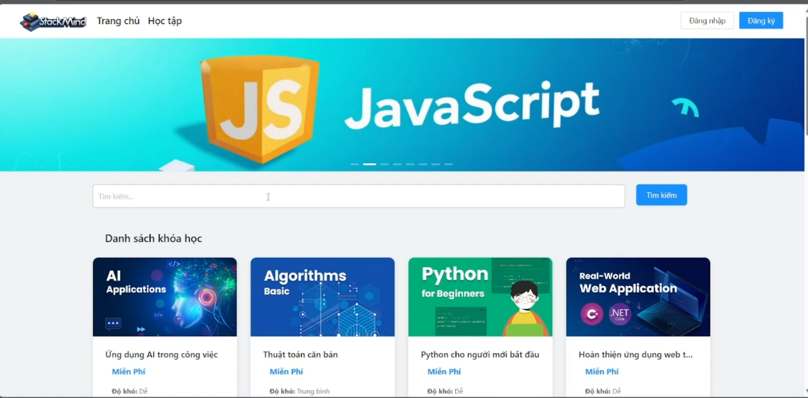
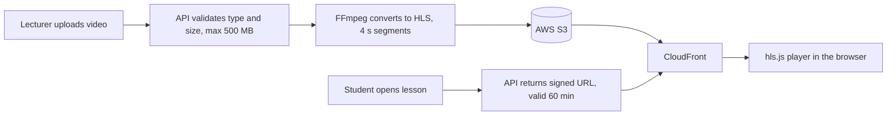

# StackMind — E-Learning Platform (Backend)

REST API for **StackMind**, an online learning platform with video lessons, exams and progress tracking.
Built as a team graduation project at UNETI (2025, graded 9.4/10). I was the team lead and main developer.
Originally written for .NET 8; upgraded to .NET 10 LTS in October 2026 ([upgrade notes](docs/upgrade-net10.md)).

Frontend (Angular 19): [Fe_QuanLyKhoaHoc](https://github.com/Strikerzzzz/Fe_QuanLyKhoaHoc)



## Features

- **Three roles:** Admin, Lecturer and Student, enforced with ASP.NET Core Identity roles and JWT bearer authentication.
- **Accounts:** registration with email confirmation, login with access and refresh tokens, account lock/unlock, role management, user statistics.
- **Courses:** lecturers build courses from lessons and lesson content (text, images, video).
- **Video streaming:** uploaded videos are converted to HLS with FFmpeg and stored in AWS S3; playback uses time-limited CloudFront signed URLs.
- **Assessments:** exams and assignments with multiple-choice and fill-in-the-blank questions; exam retakes keep the student's best score.
- **Progress and analytics:** completed lessons, course progress, results per course with search and sorting.
- 63 endpoints across 9 controllers, documented with Swagger (JWT-enabled).

## Video pipeline



FFmpeg uses NVIDIA NVENC when a GPU is detected and falls back to libx264 on the CPU.
Images skip the server: the API issues an S3 pre-signed URL and the browser uploads directly to S3.

## Tech stack

ASP.NET Core 10 · Entity Framework Core 10 · SQL Server · ASP.NET Core Identity · JWT + refresh tokens · AWS S3 · Amazon CloudFront signed URLs · FFmpeg · Swagger · Docker

## Project structure

| Folder | Contents |
|---|---|
| `Controllers/` | API endpoints |
| `Services/` | S3, CloudFront, video conversion, email, tokens, users |
| `Identity/` | `ApplicationDbContext` and entities |
| `DTO/` | Request and response models |
| `Common/` | `Result<T>` response wrapper, DI and user extensions |
| `Migrations/` | EF Core migrations |

## Getting started

Requirements: .NET 10 SDK, SQL Server, FFmpeg on `PATH`, an S3 bucket behind a CloudFront distribution, and an SMTP account.

1. Set `ConnectionStrings:DefaultConnection` in `appsettings.Development.json`, and fill the non-secret values in `appsettings.json` (`AWS:BucketName`, `AWS:Region`, `CloudFront:Domain`, `Email:SmtpHost`, `Email:SmtpUser`).
2. Keep secrets out of the repository with user-secrets:

   ```bash
   dotnet user-secrets set "Jwt:Secret" "<random string, 32+ characters>"
   dotnet user-secrets set "AWS:AccessKey" "<access key>"
   dotnet user-secrets set "AWS:SecretKey" "<secret key>"
   dotnet user-secrets set "CloudFront:PublicKeyId" "<public key id>"
   dotnet user-secrets set "Email:SmtpPass" "<smtp password>"
   ```

3. Put the CloudFront private key at `Keys/private_key.pem` (ignored by git).
4. Apply migrations and run:

   ```bash
   dotnet ef database update
   dotnet run
   ```

   Swagger UI is available in the Development environment.

**Docker:** `docker build -t stackmind-api .` (the image installs FFmpeg). Pass secrets as environment variables, for example `-e Jwt__Secret=...`.

## Screenshots

| Learning page | Lesson content editor | Results analytics |
|---|---|---|
|  |  |  |

The UI is in Vietnamese. Personal data in the screenshots is blurred.
